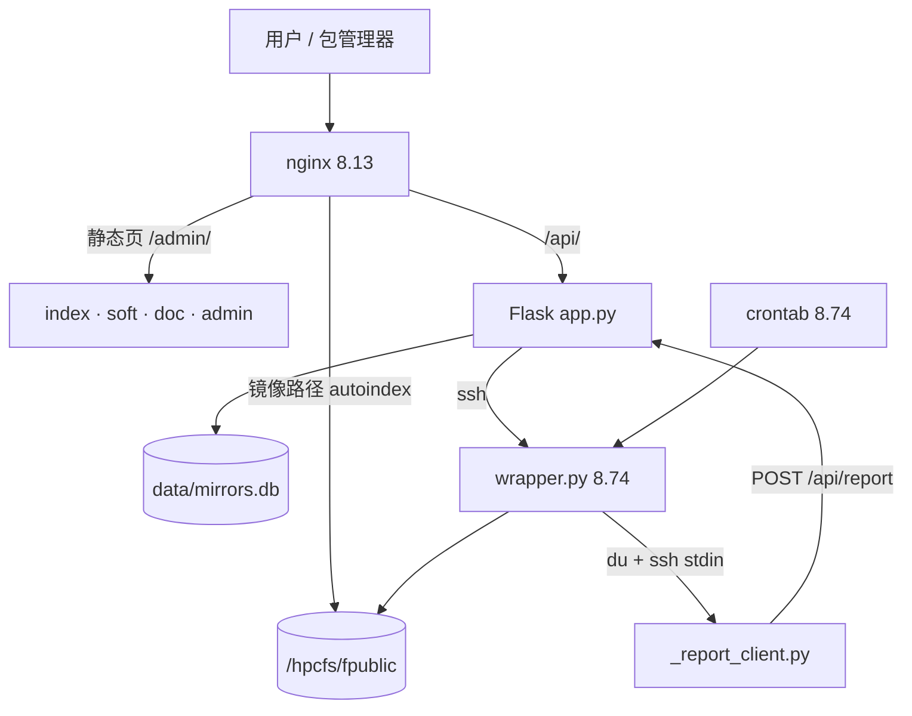
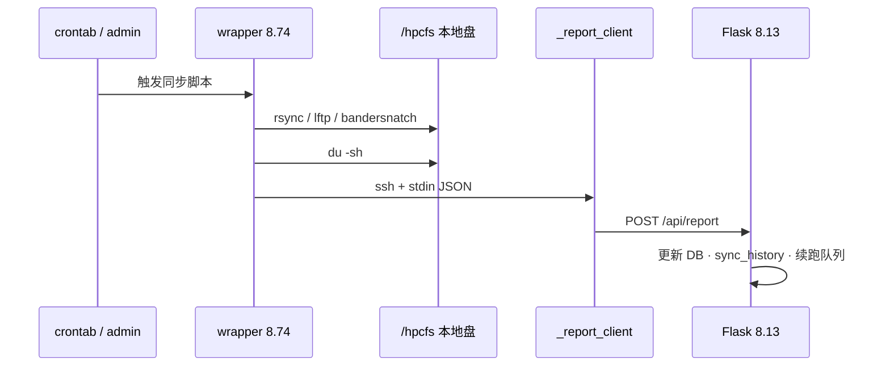

<p align="center">
  
</p>

<h1 align="center">mirrors.tibhpc.net 镜像站</h1>

<p align="center">
  <b>mirrors 镜像站</b> — 生物库 · 操作系统 · 软件源的同步、展示与下载
</p>

<p align="center">
  
  
  
  
  
</p>

<p align="center">
  <a href="https://mirrors.tibhpc.net/">用户端</a> ·
  <a href="https://mirrors.tibhpc.net/admin">管理端</a> ·
  <a href="deploy/architecture.md">架构详图</a> ·
  <a href="MEMORY.md">变更备忘</a>
</p>

<p align="center">
  
</p>

| | |
|---|---|
| 用户端 | https://mirrors.tibhpc.net/ |
| 管理端 | https://mirrors.tibhpc.net/admin |
| 现网数据 | `data/mirrors.db`（**85** 镜像：生物 **24** + 系统/软件 **61**，**73** 已接同步脚本） |

---

## 架构

两节点分工是硬约束，搞反会卡死或丢状态：

| 节点 | IP | 角色 |
|------|-----|------|
| Web | `172.16.8.13` | nginx + Flask。`/hpcfs` 是 **NFS**，**禁止本机 `du`**，只接收上报 |
| 执行机 fnode5 | `172.16.8.74` | crontab / `wrapper.py` / Ansible。`/hpcfs` 是**本地盘**，同步与 `du` 都在这里跑 |

两机共享 `/hpcfs/fpublic`；ssh 单向免密 `8.13 → 8.74`。重 IO 全部在 8.74，结果经 `_report_client.py` 回写 8.13。



**状态唯一来源**：`POST /api/report`（`X-Reload-Token`）。页面读内存 `sync_data` ← SQLite；文件下载由 nginx 直出，不经 Flask。

### 同步回写时序



---

## 仓库结构

```
.
├── app.py                 # Flask 后端（单文件）
├── _report_client.py      # 8.13 上报客户端（stdin JSON → /api/report）
├── index.html / soft.html / doc.html / loading.html / 404.html
├── admin.html + admin/    # 管理端：原生 ES module，无构建链
├── vendor/                # chart.js
├── data/
│   ├── mirrors.db         # SQLite 元数据（真库）
│   └── upstreams.json     # 上游源纳管
├── deploy/
│   ├── architecture.md
│   └── logrotate.mirrors-app
├── restart.sh             # systemctl restart flask-mirror
└── requirements.txt       # Flask + ldap3
```

同步脚本与 Ansible **不在本仓库**，在执行机共享盘：

```
/hpcfs/fpublic/manage/baiwx/script/   # wrapper.py + 各镜像同步脚本
/hpcfs/fpublic/manage/ansible/        # Ansible 控制目录（约 32 主机）
```

镜像落盘：

```
/hpcfs/fpublic/database/     # 生物库（BASE_MIRROR_PATH）
/hpcfs/fpublic/mirrors/
  ├── os_mirrors/            # 操作系统
  └── soft_mirrors/          # 软件源
```

---

## 同步与调度

### 在用链路（链路 A）

```
8.74 crontab / admin 手动触发
  → wrapper.py <脚本>
  → rsync / lftp / bandersnatch …
  → du -sh（本地盘）
  → ssh 8.13 _report_client.py
  → POST /api/report
  → 更新 mirrors / sync_history / 刷内存 / 可续跑则入 resume_queue
```

接入新镜像 = **补脚本 + 加 crontab 行**（wrapper 按 basename 匹配 key，不必改 wrapper）。

### 不要开的链路（链路 B）

`cron_sync_daemon` 读 DB `cron_expr` 裸跑脚本，**不算 size、不调 `/api/report`**。默认关闭；仅当 `ENABLE_DB_CRON_DAEMON=1` 才启动。**勿与链路 A 双开。**

DB 里的 `cron_expr` / `cron_enabled` 只是历史元数据；「下次同步时间」来自缓存的 **8.74 真实 crontab**。

### 触发方式

1. 管理端手动同步  
2. 8.74 crontab 定时  
3. `_auto_resume_daemon` 消费 `resume_queue`（超时 / 可续跑）  
4. AI 巡检可选自动重试（`AGENT_AUTO_RETRY`）

闭环探针：`GET /api/admin/loop`、`GET /healthz?deep=1`。

---

## 管理端

原生 ES module，无构建；改 `admin/js/views/*` 后清缓存即可。

```
admin.html
admin/css/{tokens,base,components}.css
admin/js/core/{api,dom,state,components,format,poller,router,chart}.js
admin/js/views/*.js          # 19 个视图，main.js registerLazy 懒加载
admin/js/main.js
```

视图：dashboard / mirrors / browse / sync / synchistory / loop / crontab / ansible / monitor / storage / nodes / traffic / upstreams / sources / logs / alerts / firewall / settings / agent。

写操作走原 API，保留 `audit_log` / `sync_history`；CSRF 与 401/403 在 `core/api.js`。禁止视图内 inline `onclick`。

nginx：`location ^~ /admin/` → 静态前端；`location = /admin` → Flask。

---

## 镜像清单

> 以 `data/mirrors.db` 为准；下表为概览。无脚本条目未接 cron，需单独排期（部分受版权/上游限制）。

### 生物数据库（24）

| key | 名称 | 路径 | 脚本 |
|-----|------|------|------|
| EBI | EBI | ebi/ | ebi.py |
| Ensembl | Ensembl-DB | ensembl/ | ensembl.py |
| GTDB | GTDB | GTDB/ | gtdb.py |
| PDB-NetXGen | PDB-NetXGen | pdb_nextgen/ | — |
| PMC | PMC | PMC/ | pmc.py |
| TARA | TARA | TARA/ | — |
| alphafill | Alphafill | alphafill/ | — |
| alphafold | AlphaFold DB | alphafold/ | alphafold.py |
| antiSMASH | antiSMASH-database | antiSMASH-database/ | — |
| biocyc | BioCyc | biocyc/ | — |
| classify_predicted_pdbs | AlphaFold2 Predicted DB | classify_predicted_pdbs/ | classify_predicted_pdbs.py |
| ddbj | DDBJ | ddbj/ | ddbj.py |
| ensembl_genomes | Ensembl Genomes | ensembl_genomes/ | ensembl_genomes.py |
| insdc | INSDC | insdc/ | — |
| interpro | InterPro | interpro/ | interpro.py |
| kegg | kegg | kegg/ | — |
| ncbi | NCBI | ncbi/ | ncbi.py |
| ncbi-opendata | NCBI Open Data | ncbi-opendata/ | ncbi_opendata_sync.py |
| pdb | PDB | pdb-redo/ | pdb.py |
| pfam | Pfam | pfam/ | pfam.py |
| prosite | Prosite | prosite/ | — |
| rcsb_pdb | RCSB PDB | pdb/ | rcsb_pdb.py |
| rhea | Rhea | rhea/ | rhea.py |
| uniprot | UniProt | uniprot/ | lftp_uniprot.py |

### 系统 / 软件源（61）

| key | 路径 | 脚本 |
|-----|------|------|
| adoptium | soft_mirrors/adoptium/ | adoptium.py |
| almalinux | os_mirrors/cd-images/almalinux/ | almalinux_sync.py |
| almalinux-elevate | os_mirrors/almalinux-elevate/ | almalinux-elevate.py |
| almalinux-epel | os_mirrors/cd-images/almalinux-epel/ | — |
| almalinux-kitten | os_mirrors/almalinux-kitten/ | almalinux-kitten.py |
| alpine | os_mirrors/alpine/ | alpine.py |
| anolis | os_mirrors/anolis/ | anolis.py |
| apptainer | soft_mirrors/apptainer/ | apptainer.py |
| archlinux | os_mirrors/archlinux/ | archlinux.py |
| archlinuxcn | os_mirrors/archlinuxcn/ | archlinuxcn.py |
| armbian | os_mirrors/armbian/ | armbian.py |
| bioconda | soft_mirrors/bioconda/ | bioconda.py |
| bioconductor | soft_mirrors/bioconductor/ | bioconductor.py |
| centos-stream | os_mirrors/centos-stream/ | centos.py |
| centos-vault | os_mirrors/cd-images/centos-vault/ | centos-vault.py |
| conda | soft_mirrors/conda/ | conda.py |
| conda-forge | soft_mirrors/conda-forge/ | conda-forge.py |
| cran | soft_mirrors/CRAN/ | cran.py |
| debian | os_mirrors/cd-images/debian-releases/ | debian.py |
| debian-apt | os_mirrors/debian/ | debian-apt.py |
| debian-security | os_mirrors/debian-security/ | debian-security.py |
| deepin | os_mirrors/deepin/ | deepin.py |
| deepin-cd | os_mirrors/cd-images/deepin/ | deepin-cd.py |
| docker-ce | soft_mirrors/docker-ce/ | docker-ce.py |
| elrepo | os_mirrors/elrepo/ | elrepo.py |
| epel | os_mirrors/epel/ | epel.py |
| fedora | os_mirrors/cd-images/fedora/ | fedora_sync.py |
| golang | soft_mirrors/golang/ | golang.py |
| julia | soft_mirrors/julia/ | julia.py |
| kali | os_mirrors/kali/ | kali.py |
| kali-images | os_mirrors/cd-images/kali/ | kali-images.py |
| kubernetes | soft_mirrors/kubernetes/ | kubernetes.py |
| mongodb | soft_mirrors/mongodb/ | mongodb.py |
| mysql | soft_mirrors/mysql/ | mysql.py |
| nodejs | soft_mirrors/nodejs-release/ | nodejs.py |
| nvidia | soft_mirrors/NVIDIA/ | nvidia.py |
| opencloudos | os_mirrors/opencloudos/ | opencloudos.py |
| openeuler | os_mirrors/cd-images/openEuler/ | openeuler.py |
| openkylin | os_mirrors/openkylin/ | openkylin.py |
| opensuse | os_mirrors/cd-images/openSUSE/ | opensuse_sync.py |
| openwrt | os_mirrors/openwrt/ | openwrt.py |
| proxmox | os_mirrors/proxmox/ | proxmox.py |
| pypi | soft_mirrors/pypi/ | pypi_sync.py |
| python | soft_mirrors/python/ | python.py |
| raspberrypi | os_mirrors/raspberrypi/ | raspberrypi.py |
| remi | os_mirrors/remi/ | remi.py |
| rhel | os_mirrors/rhel/ | — |
| rhel-iso | os_mirrors/cd-images/rhel-releases/ | — |
| rocky | os_mirrors/cd-images/rocky-releases/ | rocky_sync.py |
| rocky-vault | os_mirrors/cd-images/rocky-vault/ | rocky-vault.py |
| rpmfusion | os_mirrors/rpmfusion/ | rpmfusion.py |
| rust | soft_mirrors/rust/ | rust.py |
| spack | soft_mirrors/spack/ | spack.py |
| ubuntu | os_mirrors/ubuntu/ | ubuntu-apt.py |
| ubuntu-cd | os_mirrors/cd-images/ubuntu-releases/ | ubuntu.py |
| ubuntu-cloud-images | os_mirrors/cd-images/ubuntu-cloud-images/ | ubuntu-cloud-images.py |
| ubuntu-iso | os_mirrors/cd-images/ubuntu_official_source/ | ubuntu_iso_sync.py |
| ubuntu-ports | os_mirrors/ubuntu-ports/ | ubuntu-ports.py |
| ubuntukylin | os_mirrors/ubuntukylin/ | ubuntukylin.py |
| ubuntukylin-cd | os_mirrors/cd-images/ubuntukylin/ | ubuntukylin-cd.py |
| windows | os_mirrors/cd-images/windows-releases/ | — |

---

## 数据与依赖

**SQLite**：`data/mirrors.db`

| 表 | 用途 |
|----|------|
| `mirrors` | 镜像元数据 |
| `sync_history` | 同步历史 |
| `audit_log` | 管理端写操作审计 |
| `settings` | webhook / 告警等（GET 脱敏） |
| `resume_queue` | 超时续跑队列 |
| `ansible_runs` | Ansible 执行记录 |
| `agent_sessions` / `agent_messages` | AI 会话 |

```bash
DB=data/mirrors.db
sqlite3 -header -column $DB \
  "SELECT key,name,status,total_size_gb,last_sync_date FROM mirrors ORDER BY is_system,key;"
sqlite3 $DB "SELECT status, COUNT(*) FROM mirrors GROUP BY status;"
sqlite3 -header -column $DB \
  "SELECT key,reason,tier,attempts FROM resume_queue ORDER BY not_before;"
```

**Python**（3.10+）：

```bash
pip install -r requirements.txt   # Flask, Werkzeug, ldap3
```

密钥与网关走环境变量（缺失则拒启动），现网由 systemd `EnvironmentFile` 注入：

| 变量 | 用途 |
|------|------|
| `ADMIN_PASSWORD` | 本地 admin |
| `FLASK_SECRET_KEY` | Session |
| `RELOAD_TOKEN` | `/api/report` 等内部接口 |
| `AD_LDAP_*` | 可选域登录 |
| `ANTHROPIC_*` / `AGENT_*` | AI 巡检与技能 Agent |

---

## 部署与运维

服务：`flask-mirror.service`（绑 `127.0.0.1:5000`），前面是 nginx。

```bash
./restart.sh                          # 或 systemctl restart flask-mirror
journalctl -u flask-mirror -f
tail -f app.log
tail -f /hpcfs/fpublic/manage/baiwx/script/wrapper.log
```

**不要**手动 `python3 app.py`：会占 5000 端口，导致 systemd 反复失败。

改 AI 模型 / 密钥：

```bash
vim /etc/systemd/system/flask-mirror.env
systemctl daemon-reload && systemctl restart flask-mirror
```

后台线程（随 app 启动）：

| 线程 | 默认 | 职责 |
|------|------|------|
| `size_scan_daemon` | 开 | DB → 内存 reload（本机不 du） |
| `crontab_cache_daemon` | 开 | 缓存 8.74 crontab |
| `_auto_resume_daemon` | 开 | 消费 `resume_queue` |
| `_agent_inspect_daemon` | 开 | AI 巡检 |
| `_traffic_daemon` | 开 | 流量采样 |
| `cron_sync_daemon` | **关** | DB cron，勿开 |

大小长期「获取中」：查 8.74 wrapper / crontab 与 `/api/report` 是否成功，**不要在 8.13 跑 du**。超大库（ncbi 等）靠 cron + `resume_queue` 多轮续跑。

---

## 常用 API（摘要）

| 范围 | 路径 | 说明 |
|------|------|------|
| 公开 | `GET /api/status` | 镜像状态（已脱敏） |
| 公开 | `GET /browse/<key>/…` | 大目录分页 |
| 公开 | `GET /healthz` | 健康检查（`?deep=1` 更深） |
| 内部 | `POST /api/report` | 状态上报（`X-Reload-Token`） |
| 管理 | `/api/admin/login` 等 | 登录后 + CSRF；镜像 / sync / crontab / ansible / agent / settings … |

完整路由以 `app.py` 为准。

---

## 安全要点

- 密钥外置；Flask 仅监听本机；内部上报用 `X-Reload-Token`（`compare_digest`）
- 管理端写请求 CSRF；登录限流；settings GET 脱敏
- `sync_cmd` 首元素白名单；`sync_script` 必须在 `/hpcfs/fpublic/` 下；路径用 `realpath` 防穿越
- 防火墙页保护 22/80/443

---

## 已知约束

1. **8.13 永不本机 du** — NFS 大目录会卡死。  
2. **真调度在 8.74 crontab**；勿开 `ENABLE_DB_CRON_DAEMON`。  
3. **真库是 `data/mirrors.db`**。  
4. 执行机若 SQLite 很旧，不要写 `INSERT … ON CONFLICT`，用 UPDATE-then-INSERT / `INSERT OR REPLACE`。  
5. admin 无构建链；新视图须在 `main.js` 注册 `registerLazy`，并补 `router.js` 的 `ROUTE_META`。  
6. 部分 AI 网关上 `claude-*` 门面可能 503，模型名以 env 为准。

---

## 待办

- [ ] 无脚本镜像排期（生物：PDB-NetXGen / TARA / alphafill / antiSMASH / biocyc / insdc / kegg / prosite；系统：almalinux-epel / rhel / rhel-iso / windows 等）
- [ ] 钉钉加签 secret 写入 settings 并完成通道测试
- [ ] Flask 降权为非 root（需先配 sudoers 白名单）
