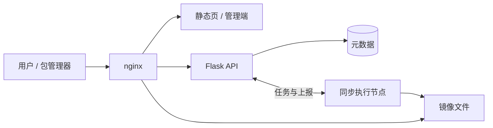
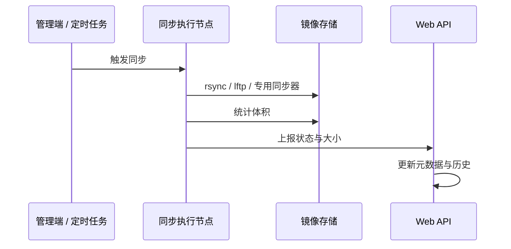

<p align="center">
  
</p>

<h1 align="center">mirrors.tibhpc.net 镜像站</h1>

<p align="center">
  <b>mirrors 镜像站</b> — 生物库 · 操作系统 · 软件源的同步、展示与下载
</p>

<p align="center">
  
  
  
  
  
</p>

<p align="center">
  <a href="https://mirrors.tibhpc.net/">用户端</a> ·
  <a href="https://mirrors.tibhpc.net/admin">管理端</a>
</p>

<p align="center">
  
</p>

---

## 简介

提供三类镜像的浏览与下载：

- **生物数据库**：NCBI、UniProt、AlphaFold、Ensembl 等
- **操作系统**：Ubuntu、Debian、Rocky、openEuler 等
- **软件源**：PyPI、Conda、CRAN、Docker、Kubernetes 等

镜像列表与状态以站点实时页面为准。

---

## 架构概览

前后端分离展示，同步与体积统计在执行节点完成，结果回写 Web 服务；文件下载由 nginx 直出。





**约定**：Web 节点不做大目录体积扫描；状态以上报接口为唯一来源。

---

## 仓库结构

```
.
├── app.py                 # Flask 后端
├── _report_client.py      # 同步结果上报客户端
├── index.html             # 用户端首页
├── soft.html / doc.html   # 软件源与文档页
├── loading.html / 404.html
├── admin.html + admin/    # 管理端（原生 ES module，无构建链）
├── vendor/                # 前端依赖
├── docs/                  # README 图示
├── deploy/                # 部署说明与日志轮转示例
├── restart.sh
└── requirements.txt
```

同步脚本、调度配置与镜像落盘目录不在本仓库公开说明中列出。

---

## 管理端

原生 ES module，无构建；视图按路由懒加载。

```
admin.html
admin/css/
admin/js/core/     # api / router / state / components …
admin/js/views/    # dashboard、mirrors、sync、crontab、agent …
admin/js/main.js
```

写操作走原有管理 API，带 CSRF；视图内禁止 inline `onclick`。

---

## 运行依赖

Python 3.10+：

```bash
pip install -r requirements.txt
```

敏感配置通过环境变量注入（缺失则拒启动），例如：

| 变量 | 用途 |
|------|------|
| `ADMIN_PASSWORD` | 本地管理员 |
| `FLASK_SECRET_KEY` | Session |
| `RELOAD_TOKEN` | 内部上报鉴权 |
| `AD_LDAP_*` | 可选域登录 |
| `ANTHROPIC_*` / `AGENT_*` | AI 巡检与技能对话 |

服务由 systemd 托管，可用 `./restart.sh` 重启。勿直接 `python3 app.py` 抢占端口。

---

## API 摘要

| 范围 | 路径 | 说明 |
|------|------|------|
| 公开 | `GET /api/status` | 镜像状态（已脱敏） |
| 公开 | `GET /browse/<key>/…` | 大目录分页浏览 |
| 公开 | `GET /healthz` | 健康检查 |
| 内部 | `POST /api/report` | 同步结果上报 |
| 管理 | `/api/admin/*` | 登录后 + CSRF |

完整路由见 `app.py`。

---

## 安全

- 密钥外置；应用仅监听本机回环，由反向代理对外
- 内部上报令牌校验；管理端 CSRF、登录限流、敏感设置脱敏
- 同步命令与脚本路径白名单；路径穿越防护
