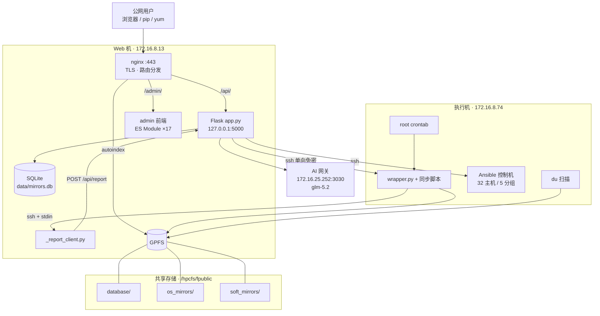
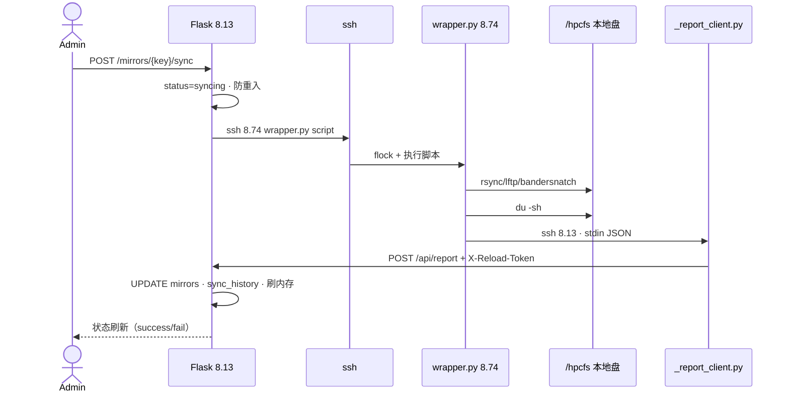
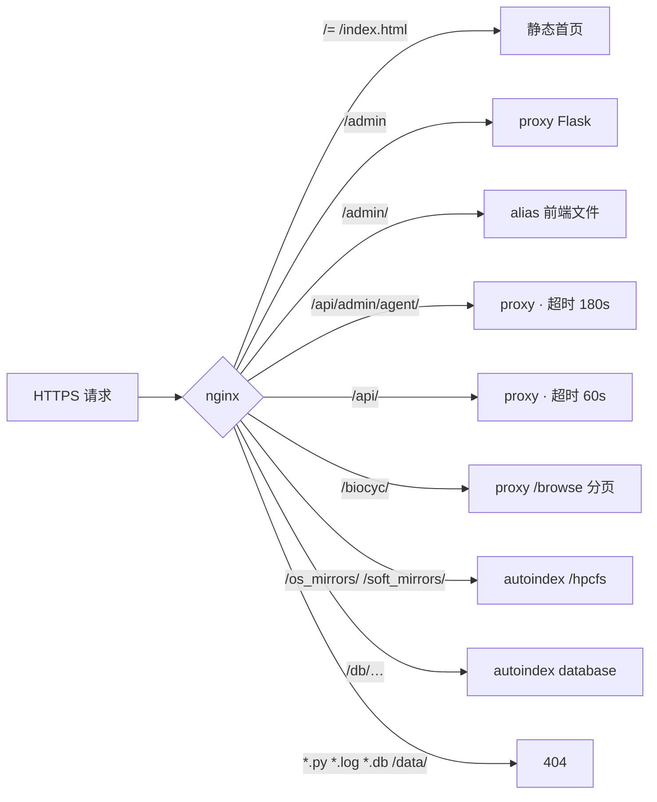
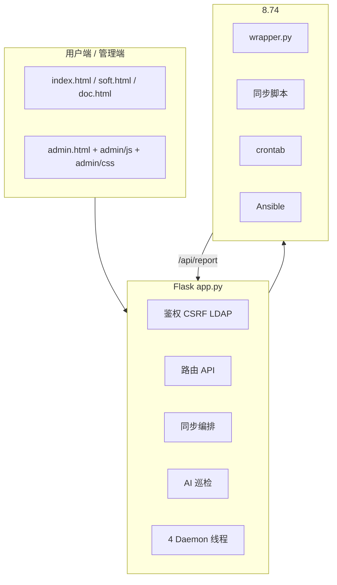
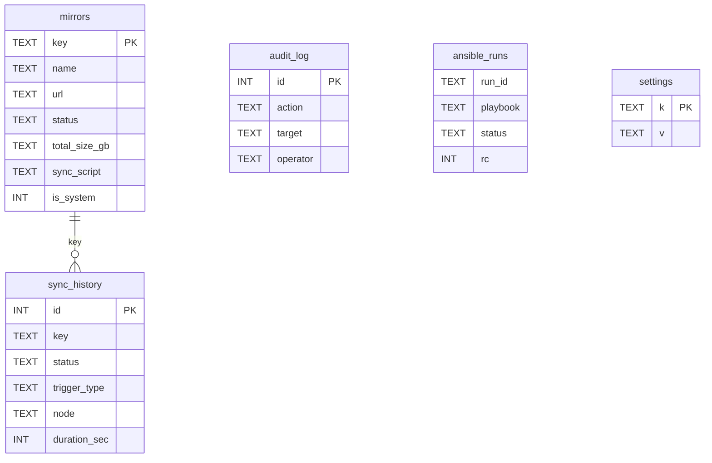

# mirrors.tibhpc.net 系统架构图

> 与代码 / nginx / SQLite 现网交叉验证。交互式版本见 Cursor Canvas。

---

## 1. 拓扑总览



**硬约束**

| 约束 | 含义 |
|------|------|
| 8.13 永不本机 `du` | `/hpcfs` 是 NFS，大目录会卡死 |
| 状态唯一来源 | `/api/report`；`save_to_db()` 不回写 `status` / `last_sync_date` |
| 链路 B 默认禁用 | `ENABLE_DB_CRON_DAEMON=0`，勿与 8.74 crontab 双开 |

---

## 2. 同步数据流（链路 A）



---

## 3. nginx 路由分发



---

## 4. 组件分层



### Flask Daemon

| 线程 | 间隔 | 默认 | 职责 |
|------|------|------|------|
| `size_scan_daemon` | 600s | 开 | DB → 内存 reload |
| `crontab_cache_daemon` | 300s | 开 | 缓存 8.74 crontab |
| `_agent_inspect_daemon` | 1800s | 开 | AI 巡检 / 自动重试 |
| `cron_sync_daemon` | 60s | **关** | DB cron 触发（勿开） |

---

## 5. 数据模型



---

## 6. 信任边界

```mermaid
flowchart LR
  PUB[公网] -->|HTTPS 只读| NGX[nginx]
  OPS[管理员] -->|Cookie + CSRF| API[/api/admin/]
  NODE74[8.74] -->|X-Reload-Token| RPT[/api/report]
  FLASK[Flask] -->|ssh 免免密| NODE74
  FLASK -->|Bearer| AI[AI 网关]
```

| 边界 | 入口 | 鉴权 |
|------|------|------|
| 公网 → nginx | :443 | 无（只读） |
| 浏览器 → admin API | Cookie | session + CSRF |
| 8.74 → report | 本机 :5000 | `X-Reload-Token` |
| 8.13 → 8.74 | ssh | 单向免密 |
| Flask → AI | 内网 HTTP | Bearer Key |
